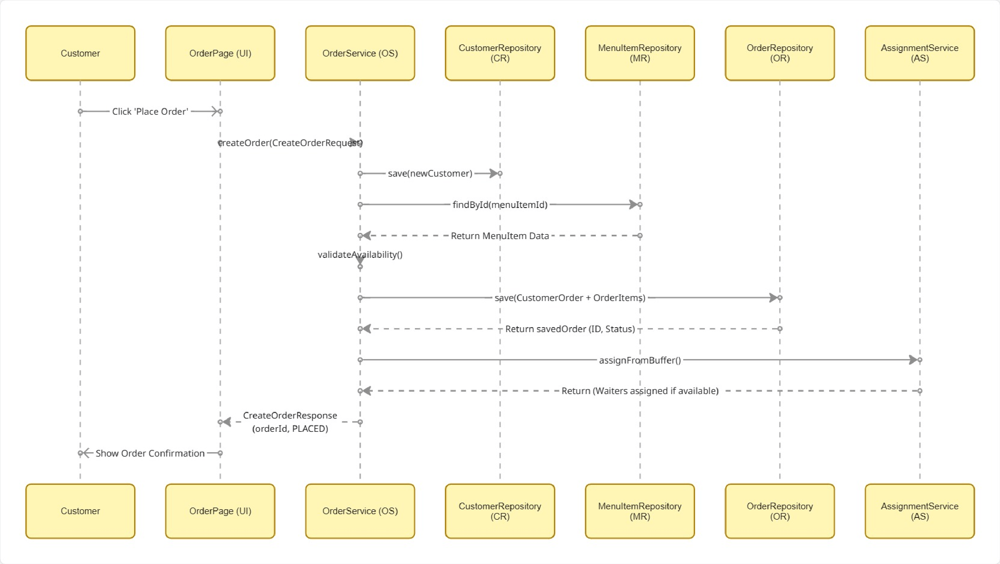

# Oaxaca Management System Report

## Table of Contents

- [Introduction](#introduction)
- [Technology Choices](#technology-choices)
- [Architecture](#architecture)
- [Database Design](#database-design)
- [UML Sequence Diagram](#uml-sequence-diagram)
- [User Stories](#user-stories)
- [Use of AI](#use-of-ai)

## Introduction
This is the introduction section

## Technology Choices

### Frontend
- React (Vite)
- TypeScript
- CSS

### Backend
- Spring Boot
- Java

### Database
- PostgreSQL / H2

## Architecture
An architecture diagram (e.g. a UML Package diagram) showing each layer (front-end/backend/database) of your application and the code modules (e.g. packages, classes or files) which exist in each layer 
A description of each of the code modules shown in the architecture diagram - this can either be written or (ideally) provided in the form of automatically generated JavaDoc or equivalent.

## Database Design
An entity relationship (ER) diagram showing the structure of your database (or equivalent if you are using a NoSQL database)

## UML Sequence Diagram
A UML Sequence Diagram for 1 User Story of your choosing, illustrating the flow of messages between the different layers/classes of your architecture

Placing an order sequence:

## User Stories
A list of User Stories (taken from the original Backlog) that are fully implemented in your product

## Use of AI
A list of features implemen